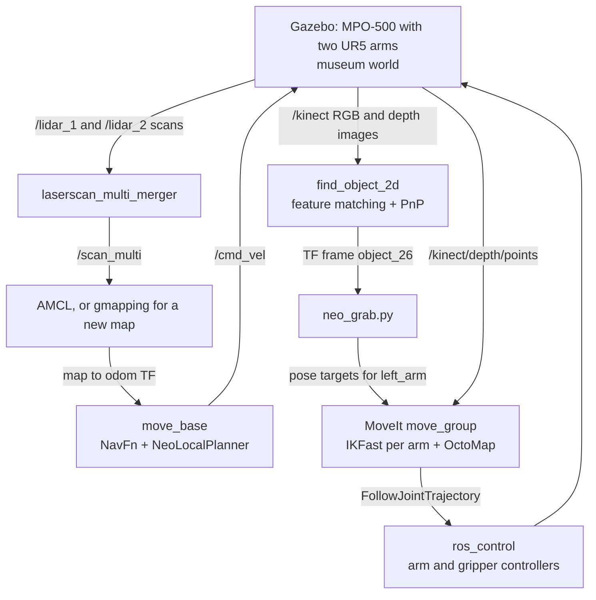

<h1 align="center">Dual-Arm Mobile Manipulator</h1>

<p align="center"><strong>Two UR5 arms on a mobile base, simulated in ROS and Gazebo.</strong></p>

<p align="center">A ROS Melodic and Gazebo simulation of a Neobotix MPO-500 mecanum base with two UR5 arms.<br>It maps, localises and navigates with two lidars, and plans for both arms with MoveIt and IKFast.</p>

<p align="center"><a href="#build">Build</a>&nbsp;&nbsp;&nbsp;&nbsp;<a href="#usage">Usage</a>&nbsp;&nbsp;&nbsp;&nbsp;<a href="#system-overview">System overview</a>&nbsp;&nbsp;&nbsp;&nbsp;<a href="#extending-it">Extending it</a>&nbsp;&nbsp;&nbsp;&nbsp;<a href="#license">License</a></p>

<br />

> One catkin workspace runs the whole robot. This repository holds the parts specific to this robot: the model, controllers, maps, navigation configs and the MoveIt setup for both arms. The navigation stack, MoveIt and the Gazebo plugins come from their own packages, through rosdep and `dependencies.repos`.

<br />

<p align="center">
  
</p>

## Features
- **Dual-arm mobile robot model.** An MPO-500 mecanum base carries a torso and two UR5 arms with grippers. The xacro model adds two SICK S300 lidars, a Kinect RGB-D camera, ros_control for the arms and grippers, and Gazebo's grasp-fix plugin so the grippers can hold objects.
- **Mapping and localisation.** laserscan_multi_merger merges the front and back lidar scans into one 360° scan. gmapping builds a map from it, and AMCL localises the robot in a saved map.
- **Navigation.** move_base plans with NavFn and Neobotix's local planner. Gazebo's planar-move plugin drives the base from `/cmd_vel`.
- **Dual-arm motion planning.** A MoveIt configuration plans for each arm with its own IKFast solver. The Kinect's point cloud feeds an OctoMap, so plans avoid obstacles the camera sees.
- **Object tracking with the arm.** find_object_2d detects a trained can in the Kinect image and publishes its pose as a TF frame. `neo_grab.py` moves the left arm to the can whenever it is more than 10 cm away along x or y.
- **Perception test bench.** A separate Gazebo world puts a fixed Kinect over a table, to run the PCL pass-through filter and the detector on their own.

## System overview



| Interface | Name | Used by |
|---|---|---|
| Lidar scans | `/lidar_1/scan_filtered` (front), `/lidar_2/scan_filtered` (back) | laser merger, move_base costmaps |
| Merged scan | `/scan_multi` | AMCL, gmapping |
| Base velocity | `/cmd_vel` | Gazebo planar-move plugin |
| Odometry | `/odom` | move_base |
| RGB-D images | `/kinect/rgb/image_raw`, `/kinect/depth/image_raw` | find_object_2d |
| Point cloud | `/kinect/depth/points` | MoveIt OctoMap |
| Object pose | TF frame `object_<id>`, for example `object_26` | `neo_grab.py` |
| Arm controllers | `/mpo_500/left_arm_controller`, `/mpo_500/right_arm_controller` (6 joints each) | MoveIt |
| Gripper controllers | `/mpo_500/left_gripper_controller`, `/mpo_500/right_gripper_controller` | MoveIt |
| Planning groups | `left_arm`, `right_arm`, `left_gripper`, `right_gripper` | MoveIt, `neo_grab.py` |

## Requirements
Last tested in 2020 with:

- Ubuntu 18.04 and ROS Melodic (desktop-full, which includes Gazebo 9)
- MoveIt 1, the navigation stack, gmapping, ira_laser_tools, neo_local_planner and find_object_2d, which rosdep installs from the package manifests
- vcstool, which fetches the source dependencies in `dependencies.repos`: neo_kinematics_mecanum, gazebo-pkgs (for the grasp plugin) and general-message-pkgs, each pinned to a 2020 commit

## Build

```bash
mkdir -p ~/catkin_ws/src && cd ~/catkin_ws/src
git clone https://github.com/AdilShaikh1/dual_arm_mobile_manipulator
vcs import < dual_arm_mobile_manipulator/dependencies.repos    # source dependencies, pinned
cd ~/catkin_ws && rosdep install --from-paths src --ignore-src -y
catkin_make && source devel/setup.bash
```

## Usage
**Start the robot.** Every workflow below runs on top of this:

```bash
roslaunch neo_simulation mpo_500_simulation_basic.launch    # museum world, robot, arm and gripper controllers
```

**Navigate in the saved map.** In new terminals:

```bash
roslaunch neo_simulation mpo_500_autonomous_navigation.launch    # merged scan, AMCL on maps/test_map.yaml, move_base
roslaunch neo_simulation mpo_500_rviz.launch config:=navigation   # send goals with 2D Nav Goal
```

**Build a new map:** run `roslaunch neo_simulation slam_gmapping.launch` instead of the navigation launch. Drive with `rosrun teleop_twist_keyboard teleop_twist_keyboard.py`, then save the map with `rosrun map_server map_saver -f ~/mpo_500_map`.

**Plan for the arms:**

```bash
roslaunch mpo_500_moveit_config move_group.launch
roslaunch mpo_500_moveit_config moveit_rviz.launch rviz_config:=$(rospack find mpo_500_moveit_config)/launch/moveit.rviz
```

**Track the can with the left arm:** with move_group running, `roslaunch neo_simulation find3d.launch` starts the detector on the robot's Kinect. Then `rosrun neo_simulation neo_grab.py` moves the arm.

**Perception test bench:** `roslaunch neo_simulation demo6d.launch` opens the bench world and shows the pass-through filter in RViz. `roslaunch neo_simulation featuredemo.launch` adds the detector.

## Demo
The robot localises and plans routes through the museum world, and its arm reaches for the can on the table.

<p align="center">
  
  
</p>
<p align="center"><em>AMCL and move_base in RViz beside the Gazebo world, at two points along a route.</em></p>

<p align="center">
  
</p>
<p align="center"><em>A UR5 arm reaching for the can on the table.</em></p>

## Extending it
- **Use your own map.** Build one with gmapping as above, then point `env_map` in `neo_simulation/config/mpo_500/amcl/mpo_500_amcl.launch` at its yaml file.
- **Swap the local planner.** `neo_simulation/launch/mpo_500/mpo_500_move_base.launch` has commented-out blocks for EBand, TEB and DWA. Uncomment one, comment out the NeoLocalPlanner block, and add that planner's package to `neo_simulation/package.xml`.
- **Change the world.** Set `world_name` in `neo_simulation/launch/mpo_500/mpo_500_world.launch`.
- **Track a different object.** Add it to the find_object_2d session `neo_simulation/session/beer.bin`, then change `obj = "object_26"` in `neo_simulation/pcl/demo/neo_grab.py` to its frame.
- **Change an arm.** After editing the arm's xacro, regenerate its IKFast solver and run `mpo_500_left_arm_ikfast_plugin/update_ikfast_plugin.sh`, or the right arm's script, to rebuild the MoveIt plugin around it.

## Repository layout
- `neo_simulation/`: robot model and meshes, Gazebo worlds and models, controllers, mapping and navigation configs, the perception demo (`neo_simulation/pcl/`) and scripts
- `mpo_500_moveit_config/`: MoveIt configuration for both arms (OMPL and CHOMP pipelines)
- `mpo_500_left_arm_ikfast_plugin/`, `mpo_500_right_arm_ikfast_plugin/`: IKFast kinematics plugins, one per arm
- `dependencies.repos`: source dependencies for vcstool
- `pics/`: screenshots
- `CHANGELOG.md`: release history

## Limitations
- It targets ROS Melodic, which reached end of life in May 2023.
- `neo_grab.py` moves the arm to the can. It doesn't close the gripper.
- `neo_simulation/` still holds Neobotix's files for its other robots (MM-400, MMO-500, MMO-700, MPO-700), unchanged. They need Neobotix packages that this repository doesn't list.

## License
This repo is BSD 3-Clause licensed (see LICENSE). Files from other projects keep their own licenses:

- `neo_simulation/` started as a copy of Neobotix's [neo_simulation](https://github.com/neobotix/neo_simulation), taken in June 2020 under its BSD license. Neobotix's authors stay listed in its package.xml.
- `neo_simulation/launch/mpo_500/laserscan_multi_merger.launch` is adapted from [ira_laser_tools](https://github.com/iralabdisco/ira_laser_tools) (BSD 3-Clause).
- The Gazebo models in `neo_simulation/models/` keep the authors listed in their `model.config` files.
- `neo_simulation/pcl/meshes/base.stl` comes from [Robot_manipulator](https://github.com/AdilShaikh1/Robot_manipulator) (MIT).
- Generated IKFast solver code keeps its original license header.
